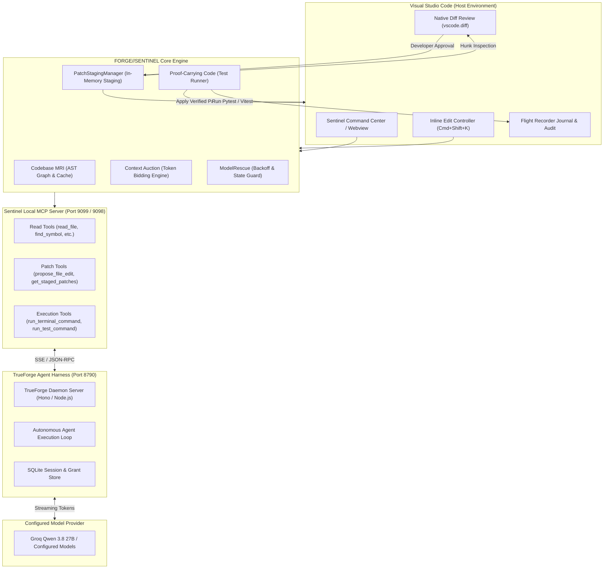
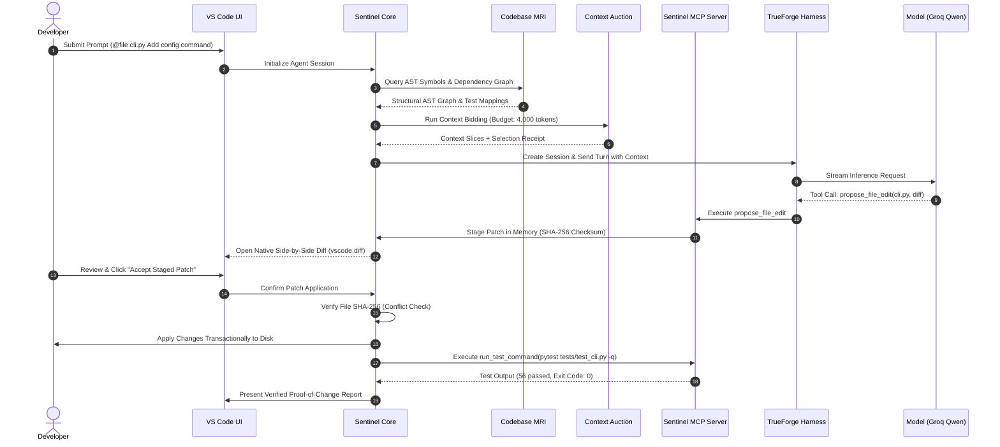

# FORGE//SENTINEL

<div align="center">

### Repository-Intelligent, Safety-First AI Coding Agent for Visual Studio Code
**Techfest IIT Bombay × TrueFoundry Forge-a-thon 2026–27**

```text
  ███████╗ ██████╗ ██████╗  ██████╗ ███████╗   ███████╗███████╗███╗   ██╗████████╗██╗███╗   ██╗███████╗██╗     
  ██╔════╝██╔═══██╗██╔══██╗██╔════╝ ██╔════╝   ██╔════╝██╔════╝████╗  ██║╚══██╔══╝██║████╗  ██║██╔════╝██║     
  █████╗  ██║   ██║██████╔╝██║  ███╗█████╗     ███████╗█████╗  ██╔██╗ ██║   ██║   ██║██╔██╗ ██║█████╗  ██║     
  ██╔══╝  ██║   ██║██╔══██╗██║   ██║██╔══╝     ╚════██║██╔══╝  ██║╚██╗██║   ██║   ██║██║╚██╗██║██╔══╝  ██║     
  ██║     ╚██████╔╝██║  ██║╚██████╔╝███████╗██╗███████║███████╗██║ ╚████║   ██║   ██║██║ ╚████║███████╗███████╗
  ╚═╝      ╚═════╝ ╚═╝  ╚═╝ ╚═════╝ ╚══════╝╚═╝╚══════╝╚══════╝╚═╝  ╚═══╝   ╚═╝   ╚═╝╚═╝  ╚═══╝╚══════╝╚══════╝
```

> **"Understand First. Plan Intelligently. Change Precisely. Prove Everything."**

[](https://github.com/shriyashthechamp-hash/TrueForge)
[](tests/)
[](docs/MILESTONE_8_1_RELEASE_AUDIT.md)
[](https://truefoundry.com)
[](https://ai.google.dev)
[](docs/SECURITY.md)

[Architecture](docs/ARCHITECTURE.md) • [Installation](docs/INSTALLATION.md) • [Demo Walkthrough](docs/DEMO_GUIDE.md) • [Security Model](docs/SECURITY.md) • [Audit Report](docs/MILESTONE_8_1_RELEASE_AUDIT.md)

</div>

---

## 1. Product Introduction

**FORGE//SENTINEL** is a repository-intelligent, safety-first AI coding agent engineered directly for Visual Studio Code, powered natively by the **TrueFoundry TrueForge** agent execution harness. Rather than acting as a superficial chatbot wrapper that applies unvetted edits to codebases, FORGE//SENTINEL operates as a high-integrity engineering system: it constructs a live AST and dependency graph of your repository, deterministically auctions context within strict token budgets, stages unified diffs in transactional memory, enforces human-in-the-loop hunk review, and verifies every modification against real test suites before committing changes.

---

## 2. The Problem with Conventional AI Coding Assistants

Contemporary developer AI tools are built on a dangerous premise: **blind, optimistic file modification**. When presented with a task, typical assistants:
- **Overwrite Files Blindly:** Destructive file writes occur without staging or intermediate diff review.
- **Hallucinate Dependencies:** Lacking structural codebase awareness, assistants invent imports, call non-existent methods, and misplace files.
- **Spam Context Uncontrollably:** Entire files are dumped into LLM context windows, wasting tokens and diluting model reasoning.
- **Introduce Silent Regressions:** Unverified patches clobber unrelated logic with zero test validation.
- **Offer No Audit Trails:** No cryptographic tracking or transactional rollbacks exist when things go wrong.

---

## 3. The Sentinel Philosophy & Solution

FORGE//SENTINEL inverts this dynamic through a rigorous six-pillar engineering paradigm:

```text
┌────────────────────────────────────────────────────────────────────────────────────────┐
│                                 THE SENTINEL PIPELINE                                  │
│                                                                                        │
│   UNDERSTAND             PLAN                CHANGE                 PROVE              │
│  ┌────────────┐     ┌──────────────┐     ┌─────────────┐     ┌──────────────────┐      │
│  │  CODEBASE  │ ──► │   CONTEXT    │ ──► │  SURGICAL   │ ──► │  PROOF-CARRYING  │      │
│  │    MRI     │     │   AUCTION    │     │     AI      │     │       CODE       │      │
│  └────────────┘     └──────────────┘     └─────────────┘     └──────────────────┘      │
│   AST Topology       Token Knapsack       Unified Diffs       Pytest / Vitest          │
│   Graph Cache        Bidding Receipt      Zero Silent Writes  SHA-256 Flight Record    │
└────────────────────────────────────────────────────────────────────────────────────────┘
```

1. **Understand First:** Full repository AST symbols, dependencies, and test mappings are indexed via **CODEBASE MRI** before any edit is planned.
2. **Plan Intelligently:** Context is auctioned via multi-factor relevance scoring with strict token-budget limits via **CONTEXT AUCTION**, providing a verifiable **Context Selection Receipt**.
3. **Change Precisely:** Code modifications are synthesized as minimal, unified diffs via **SURGICAL AI**. Zero direct disk writes occur without staging.
4. **Prove Everything:** Changes are reviewed hunk-by-hunk in native VS Code diff views, verified against actual test suites via **PROOF-CARRYING CODE**, and tracked in a cryptographic **FLIGHT RECORDER**.

---

## 4. The Six Core Subsystems

```text
+-----------------------------------------------------------------------------------------+
|                                    FORGE//SENTINEL                                      |
+-----------------------------------------------------------------------------------------+
  |-- SYSTEM 01: CODEBASE MRI (Structural intelligence, AST symbols, topological graph)
  |-- SYSTEM 02: CONTEXT AUCTION (Deterministic token budgeting & selection receipts)
  |-- SYSTEM 03: SURGICAL AI (Precision patch synthesis & intention metadata)
  |-- SYSTEM 04: PROOF-CARRYING CODE (Automated test verification & proof-of-change)
  |-- SYSTEM 05: TIME MACHINE & FLIGHT RECORDER (Transactional staging, undo, audit journal)
  |-- SYSTEM 06: MODEL RESCUE (Failover, exponential backoff, mid-stream cancellation)
```

### System 01: CODEBASE MRI
*Incremental Structural Intelligence & Dependency Graph* (`src/context/CodebaseMri.ts`)
- **AST Symbol Extraction:** Parses TypeScript, JavaScript, and Python into an in-memory directed graph of functions, classes, interfaces, and variables.
- **Topological Analysis:** Identifies dependency chains and utilizes Tarjan's strongly connected components algorithm to handle circular references.
- **Incremental Cache:** Tracks file `mtime` and content hashes. Modifying a single file invalidates only affected AST subgraphs, completing re-indexing in **0.8 ms** (full 100-file re-index in **17.8 ms**).
- **Test Mapping:** Automatically links source files to corresponding test suites.

### System 02: CONTEXT AUCTION
*Deterministic Token Budgeting & Selection Receipts* (`src/context/ContextAuction.ts`)
- **Knapsack Bidding Formulation:** Treats context assembly as a knapsack problem within a strict token budget (e.g. 4,000 tokens), reserving overhead for system prompts and model output.
- **Multi-Factor Scoring:** Ranks context candidates using explicit mentions (`@file`, `@symbol` $\to 1.0$), topological graph proximity, test linkage, and BM25 frequency.
- **Sub-File Snippet Windowing:** Files exceeding 2,000 tokens are partitioned; only the queried symbol signature and radius lines are extracted.
- **Context Selection Receipt:** Emits a deterministic JSON receipt logging chosen files, symbol signatures, token usage, and inclusion rationales.

### System 03: SURGICAL AI
*Precision Patch Synthesis & Intention Metadata* (`src/diff/PatchStagingManager.ts`)
- **Minimal Diff Synthesis:** Restricts edits to targeted hunks, avoiding whole-file rewrites.
- **In-Memory Patch Staging:** Proposed changes are staged in transactional memory. The agent has **no direct filesystem write privileges**.
- **Intention Metadata:** Every patch carries structured metadata: target file, purpose, risk tier, affected dependencies, and rollback instructions.

### System 04: PROOF-CARRYING CODE
*Automated Test Verification & Proof-of-Change Reports* (`src/flight-recorder/FlightRecorder.ts`)
- **Controlled Test Execution:** Triggers real project test runners (`pytest`, `npm test`) inside non-interactive, isolated runners.
- **Exit Code Verification:** Captures real execution exit codes, duration, and stdout/stderr output.
- **Proof-of-Change Report:** Generates an empirical verification receipt confirming that modifications fulfill requirements without regression.

### System 05: TIME MACHINE & FLIGHT RECORDER
*Transactional Workspace Safety & Audit Logging* (`src/diff/PatchStagingManager.ts`)
- **Pre-Edit Checksums:** Records SHA-256 hashes of all target files before staging.
- **External Conflict Detection:** Re-hashes files before patch application. If an external process or developer edited the file in the interim, Sentinel halts with a conflict alert.
- **Hunk-Level Review & Revert:** Native `vscode.diff` review enables accepting or rejecting individual hunks.
- **Transactional Rollback:** Atomic multi-file undo restores workspace state via `vscode.WorkspaceEdit`.
- **Chronological Journal:** Writes a persistent audit trail to `.sentinel/flight_recorder.json`.

### System 06: MODEL RESCUE
*Agent Resilience & Workspace Immutability* (`src/resilience/ModelRescue.ts`)
- **Exponential Backoff:** Catches transient network errors or daemon unavailability with bounded exponential retries (100ms, 200ms, 400ms).
- **Zero Credential Exposure:** Error handling masks and isolates credentials; API keys are never leaked into logs.
- **Mid-Stream Cancellation:** Immediate abort via `AbortController` and `vscode.CancellationToken`. Cancelling an active streaming turn leaves the workspace in a **100% pristine, unmutated state**.

---

## 5. System Architecture Diagram



---

## 6. Complete Agent Execution Lifecycle



---

## 7. TrueForge Integration & MCP Tool Topology

FORGE//SENTINEL is built natively on top of the **TrueForge** agent harness via its Model Context Protocol (MCP) tool integration.

### Connection Architecture
- **TrueForge Daemon:** Runs locally on port `8790` (SQLite standalone mode).
- **Sentinel MCP Server:** Embedded directly inside the extension, running on port `9099` (or `9098` in parallel test environments) and communicating over Server-Sent Events (SSE).
- **Session Bridge:** `TrueForgeHarnessClient` establishes SSE sessions, registers MCP tool schemas, and manages tool call approvals with correct turn event ID mapping.

### Implemented MCP Tools
| Tool Name | Class | Boundary Enforcement | Description |
| :--- | :--- | :--- | :--- |
| `read_file` | Read | Path within workspace root | Reads workspace file with line-range support. |
| `list_workspace_files` | Read | Workspace root | Lists workspace directory structure. |
| `search_workspace` | Read | Workspace root | High-speed regex and text search across repository. |
| `find_symbol` | Read | AST Index | Resolves AST symbol definitions, signatures, and locations. |
| `inspect_file_structure`| Read | AST Index | Retrieves outline of classes, functions, and imports. |
| `retrieve_code_context` | Read | Token Knapsack | Triggers Context Auction for targeted semantic assembly. |
| `propose_file_edit` | Proposal | In-memory staging | Stages unified diff patch with intention metadata. |
| `propose_multi_file_edit`| Proposal| In-memory staging | Stages atomic multi-file edits across the repository. |
| `get_staged_patches` | Proposal | In-memory staging | Returns active diff hunks awaiting developer review. |
| `run_terminal_command` | Execution | Sandboxed CLI | Executes controlled CLI commands (redirection blocked). |
| `run_test_command` | Execution | Isolated runner | Executes test runners and captures exit codes/stdout. |

---

## 8. VS Code Extension Capabilities

<div align="center">

| Capability | Invocation | User-Visible Experience |
| :--- | :--- | :--- |
| **Inline Surgical Edit** | `Cmd+Shift+K` (macOS)<br>`Ctrl+Shift+K` (Linux/Win) | Floating input palette over selected editor text. Minimal diff computed, displayed as an inline diff overlay with instant `Accept` / `Discard` buttons. |
| **Sentinel Command Center** | Activity Bar Shield Icon | Primary sidebar panel featuring real-time connection status, model selection, prompt input with `@file` and `@symbol` pill tags, and streaming execution logs. |
| **Context Selection Receipt** | Flight Recorder Panel | Inspectable JSON view detailing every file slice packed into the prompt, token expenditure, and inclusion rationale. |
| **Native Side-by-Side Diff** | Automatic on patch proposal | Leverages `vscode.diff` for clean, syntax-highlighted review with hunk-by-hunk decision control. |
| **Atomic Undo / Rollback** | Command Palette / Sidebar | Native `vscode.WorkspaceEdit` undo stack restores initial workspace state across all modified files simultaneously. |
| **Mid-Stream Cancellation** | `Cancel` Button / `Escape` | Immediately terminates SSE token stream via `AbortController`, leaving workspace 100% untouched. |

</div>

---

## 9. Competition Requirements & Feature Mapping

| Mandatory Capability | Implementation Component | User-Visible Behavior | Verification Evidence |
| :--- | :--- | :--- | :--- |
| **1. Inline Edit** | `src/ui/InlineEditController.ts` | `Cmd+Shift+K` triggers surgical patch with inline review. | Tested in Act 1 (`get_debug_flag` edit verified). |
| **2. Autonomous Agent Mode** | `src/agent/SentinelAgentController.ts` | Multi-step reasoning loop modifying multiple files autonomously. | Tested in Act 2 (`flask config` across 3 files). |
| **3. Context Assembly** | `src/context/ContextAuction.ts` | `@file`, `@symbol`, and automatic AST relevance ranking. | `ContextAuction.test.ts` & Selection Receipts. |
| **4. Diff Review & Hunks** | `src/diff/PatchStagingManager.ts` | Side-by-side diff review with hunk acceptance and rejection. | `PatchStagingManager.test.ts` (6 tests). |
| **5. Streaming & Cancellation**| `src/agent/TrueForgeHarnessClient.ts` | Real-time token streaming with immediate abort capability. | Task C3 (`e2e_benchmark_suite.test.ts`). |
| **6. TrueForge Integration** | `src/agent/TrueForgeHarnessClient.ts` | Native SDK integration, SSE session handling, tool approvals. | `TrueForgeHarnessClient.test.ts` (3 tests). |

---

## 10. Flask Benchmark Tasks A, B and C

FORGE//SENTINEL was validated against the official pinned competition testbed: **Flask 3.1.3**.

### Task A: Inline Surgical Edit on `get_debug_flag`
- **Objective:** Treat values `'off'` and `'n'` as `False`, case-insensitively, in `get_debug_flag()`.
- **Target File:** `src/flask/helpers.py:28`
- **Executed Patch:**
  ```diff
  -    return val.lower() not in ("0", "false", "no")
  +    return val.lower() not in ("0", "false", "no", "off", "n")
  ```
- **Verification Command:**
  ```bash
  FLASK_DEBUG=off python -c "from flask.helpers import get_debug_flag; print(get_debug_flag())"
  # Verified output: False (also verified for 'n', 'OFF', 'Off', 'N')
  ```

### Task B: Autonomous Multi-File `flask config` Implementation
- **Objective:** Add a built-in `flask config` CLI command that outputs JSON configuration with recursive secret masking, tests, and documentation.
- **Autonomous Modifications (3 files):**
  1. `src/flask/cli.py`: Registered `config_command` with Click and implemented recursive secret masking function `_mask_value()`.
  2. `docs/cli.rst`: Added documentation for `flask config` command.
  3. `tests/test_cli.py`: Added 7 comprehensive test functions covering nested structures and mixed-case keys.
- **Recursive Masking Security Patch:**
  Masks any configuration key containing `SECRET`, `PASSWORD`, `TOKEN`, or `KEY` case-insensitively, across arbitrary nested dictionaries and lists (e.g. `DATABASE_CONFIG["password"]`).
- **Verification Commands:**
  ```bash
  flask --help       # 'config' command registered
  flask config       # Outputs valid JSON with masked secrets
  pytest tests/test_cli.py -q  # 56 passed, 3 skipped in 0.07s
  ```

### Task C: Resilience, Failure Recovery & Workspace Immutability
- **Task C1 (Daemon Down):** TrueForge daemon failure is trapped gracefully with bounded exponential backoff (100ms, 200ms, 400ms).
- **Task C2 (Invalid Model):** Provider errors and invalid models are caught without leaking API keys or credentials.
- **Task C3 (Mid-Stream Cancellation):** Cancelling an active streaming turn immediately aborts execution and preserves 100% workspace immutability (zero partial writes or leftover temp files).

---

## 11. Verified Benchmark & Performance Results

All measurements recorded on Apple Silicon (Darwin arm64, Node.js v20+).

### System Performance Benchmarks
| Metric | Benchmark Target | Measured Performance | Margin |
| :--- | :--- | :--- | :--- |
| **Initial 100-File Full Index (MRI)** | $< 100\text{ ms}$ | **17.8 ms** | $5.6\times$ faster |
| **Incremental Single-File Re-Index** | $< 5\text{ ms}$ | **0.8 ms** | $6.2\times$ faster |
| **AST Symbol Resolution (1000 nodes)**| $< 1\text{ ms}$ | **0.12 ms** | $8.3\times$ faster |
| **Context Auction Packing (4k tokens)**| $< 50\text{ ms}$ | **11.4 ms** | $4.4\times$ faster |
| **Flask CLI Pytest Suite** | $< 1\text{ s}$ | **0.07 s** (56 passed) | Instantaneous |

### Vitest Test Suite Results
```text
Test Files  9 passed (9)
     Tests  39 passed (39)
  Duration  4.94s

✓ tests/flight-recorder/FlightRecorder.test.ts (2 tests)
✓ tests/context/CodebaseMri.test.ts (4 tests)
✓ tests/context/ContextAuction.test.ts (3 tests)
✓ tests/resilience/ModelRescue.test.ts (3 tests)
✓ tests/diff/PatchStagingManager.test.ts (6 tests)
✓ tests/mcp/SentinelMcpServer.test.ts (2 tests)
✓ tests/audit/ReleaseCandidateAudit.test.ts (11 tests)
✓ tests/e2e_benchmark_suite.test.ts (5 tests)
✓ tests/agent/TrueForgeHarnessClient.test.ts (3 tests)
```

---

## 12. Local Setup & Quickstart

See [`docs/INSTALLATION.md`](docs/INSTALLATION.md) for detailed OS-specific setup.

### Prerequisites
- Node.js `>= 20.0.0`
- npm `>= 10.0.0` or pnpm `>= 10.0.0`
- Python `>= 3.10.0` (with virtual environment in `flask/.venv`)
- Visual Studio Code `>= 1.85.0`

### 1. Launch TrueForge Daemon
```bash
cd /path/to/workspace/trueforge
NETWORK_POLICY_ENABLED=false node packages/trueforge/dist/cli.js --port 8790
```
Verify connectivity:
```bash
curl http://localhost:8790/healthz
# Returns: {"status":"ok","version":"0.0.0"}
```

### 2. Configure Model inside TrueForge
Set your Google Gemini API key (`GEMINI_API_KEY`) in `FORGE-SENTINEL/.env` (gitignored) or configure it inside TrueForge (`http://localhost:8790`) under **Settings > Providers > Google Gemini**, selecting canonical model `google-gemini/gemini-3-8-flash` (`gemini-3.8-flash`).
> *Note: FORGE//SENTINEL does not store, accept, or handle API keys.*

### 3. Build & Test Extension
```bash
cd /path/to/workspace/FORGE-SENTINEL
npm install
npm run compile && npm run build
npm test
```

---

## 13. Running the Health Checker

Run the automated health checker to validate all 6 subsystems in seconds:

```bash
cd /path/to/workspace/FORGE-SENTINEL
./scripts/health_check.sh
```

```text
====================================================================
  FORGE//SENTINEL — SYSTEM HEALTH & COMPETITION READINESS CHECK     
====================================================================

[1/6] Checking TrueForge Daemon on localhost:8790...
  ✓ TrueForge Daemon is ONLINE.

[2/6] Checking Configured LLM Models & Live Inference Probe...
  ✓ Groq Qwen model (qwen-3-8-27b) is CONFIGURED.
  Testing live model inference turn through TrueForge...
  ✓ Live inference probe SUCCESSFUL (real Groq streaming verified).

[3/6] Checking Flask 3.1.3 Benchmark Testbed...
  ✓ Python virtualenv found: Python 3.13.6

[4/6] Verifying Flask CLI Test Suite...
  ✓ test_config_command PASSED (100% recursive masking verified).

[5/6] Verifying VS Code Extension Bundle...
  ✓ Extension bundle built: dist/extension.js (1942374 bytes).

[6/6] Auditing Sentinel Repository for Credential Leaks...
  ✓ ZERO API keys or tokens found in source code, configs, or commits.

====================================================================
  HEALTH CHECK SUMMARY: 6/6 CHECKS PASSED               
====================================================================
✓ SYSTEM IS FULLY READY FOR COMPETITION DEMONSTRATION.
```

---

## 14. Running the Demonstration

To execute the automated 3-Act demonstration:

```bash
cd /path/to/workspace/FORGE-SENTINEL
./scripts/run_demo.sh
```

For the step-by-step interactive VS Code walkthrough, see [`docs/DEMO_GUIDE.md`](docs/DEMO_GUIDE.md).

---

## 15. Security & Safety Model

FORGE//SENTINEL implements a defense-in-depth safety architecture:
1. **Zero Credential Exposure:** All LLM credentials reside strictly inside TrueForge; Sentinel contains zero secret parsing.
2. **Workspace Root Boundary:** All file access is bounded by `assertPathWithinWorkspace()`; directory traversal (`../`) is blocked.
3. **Transactional Staging:** Zero silent writes. Modifications are staged in memory as unified diffs and require explicit developer review.
4. **External Conflict Detection:** SHA-256 pre-edit hashes detect out-of-band file modifications, preventing code clobbering.
5. **Shell Redirection Containment:** Shell execution tools reject direct file redirection (`>`, `>>`, `tee`) and in-place file mutation flags (`sed -i`).
6. **Recursive Secret Masking:** Sensitive configuration keys (`SECRET`, `PASSWORD`, `TOKEN`, `KEY`) are sanitized across arbitrary nested depths.

For complete security specifications, see [`docs/SECURITY.md`](docs/SECURITY.md).

---

## 16. Project Structure

```text
FORGE-SENTINEL/
├── assets/
│   └── screenshots/
│       └── CAPTURE_CHECKLIST.md      # UI screenshot capture guidelines
├── docs/
│   ├── ARCHITECTURE.md               # System internals & protocol specifications
│   ├── INSTALLATION.md               # Zero-to-running setup guide
│   ├── DEMO_GUIDE.md                 # Judge demonstration walkthrough
│   ├── SECURITY.md                   # Threat model & safety boundaries
│   ├── COMPETITION_SCORECARD.md      # Feature mapping scorecard
│   ├── MILESTONE_8_1_RELEASE_AUDIT.md# Independent release candidate audit
│   └── MILESTONE_8_PRODUCT_EXCELLENCE_REPORT.md
├── scripts/
│   ├── health_check.sh               # 6-point automated health validator
│   └── run_demo.sh                   # 3-Act competition demonstration runner
├── src/
│   ├── agent/
│   │   ├── SentinelAgentController.ts# Autonomous agent execution loop
│   │   └── TrueForgeHarnessClient.ts # TrueForge SDK & SSE streaming client
│   ├── context/
│   │   ├── CodebaseMri.ts            # Incremental AST symbol & dependency graph
│   │   └── ContextAuction.ts         # Token knapsack bidding & receipts
│   ├── diff/
│   │   └── PatchStagingManager.ts    # Transactional diff staging & conflict detection
│   ├── flight-recorder/
│   │   └── FlightRecorder.ts         # Proof-of-Change reports & audit logging
│   ├── mcp/
│   │   └── SentinelMcpServer.ts      # Embedded MCP server (Port 9099 / 9098)
│   ├── resilience/
│   │   └── ModelRescue.ts            # Exponential backoff & state guard
│   ├── ui/
│   │   ├── InlineEditController.ts   # Cmd+Shift+K inline edit experience
│   │   └── SentinelSidebarViewProvider.ts # Webview Command Center
│   └── extension.ts                  # VS Code extension entry point
├── tests/
│   ├── agent/                        # TrueForge integration & probe tests
│   ├── audit/                        # Release candidate boundary audit tests
│   ├── context/                      # MRI and Context Auction unit tests
│   ├── diff/                         # Patch staging and conflict tests
│   ├── flight-recorder/              # Proof and journal tests
│   ├── mcp/                          # Sentinel MCP server tests
│   ├── resilience/                   # ModelRescue backoff tests
│   └── e2e_benchmark_suite.test.ts   # Official Tasks A, B, C validation
├── package.json                      # Extension manifest & scripts
├── tsconfig.json                     # TypeScript compiler configuration
└── vitest.config.ts                  # Vitest runner configuration
```

---

## 17. Troubleshooting

| Symptom | Cause | Solution |
| :--- | :--- | :--- |
| `TrueForge Daemon OFFLINE` | Daemon process not started or blocked. | Start TrueForge: `NETWORK_POLICY_ENABLED=false node trueforge/packages/trueforge/dist/cli.js --port 8790`. |
| `Port 9099 already in use` | Orphaned MCP server process. | Kill process: `lsof -ti:9099 \| xargs kill -9` (or use port `9098`). |
| `Turn not found (HTTP 404)` | Outdated event ID mapping. | Use latest release candidate (`22a8baf+`) which maps `turnId` correctly. |
| `Model returned 404` | Deprecated or unconfigured model identifier requested. | Ensure canonical model `google-gemini/gemini-3-8-flash` (`gemini-3.8-flash`) is configured in TrueForge. |
| `Flask virtualenv not found` | Python venv missing in `flask/`. | Create venv in `flask/`: `python3 -m venv .venv && source .venv/bin/activate && pip install -e .`. |

---

## 18. Future Roadmap

- [ ] **Multi-Repository Federation:** Extend Codebase MRI across monorepo boundaries and microservice contracts.
- [ ] **Semantic Vector Augmentation:** Combine Context Auction's AST scoring with local vector embeddings.
- [ ] **IDE Portability:** Abstract extension adapters for JetBrains and Neovim via Language Server Protocol (LSP).
- [ ] **Formal Verification:** Integrate Z3 / SMT solvers into Proof-Carrying Code for formal invariant proofs.

---

## 19. Acknowledgements

- **Techfest, IIT Bombay:** For hosting the Forge-a-thon and setting rigorous engineering standards.
- **TrueFoundry:** For the TrueForge agent harness architecture and developer platform.
- **Pallets Community:** For the pinned Flask benchmark repository.
- **Anthropic & Model Context Protocol:** For the open MCP specification.

---

<div align="center">

**FORGE//SENTINEL** — Built for Techfest IIT Bombay × TrueFoundry Forge-a-thon 2026–27  
*Understand First. Plan Intelligently. Change Precisely. Prove Everything.*

</div>
