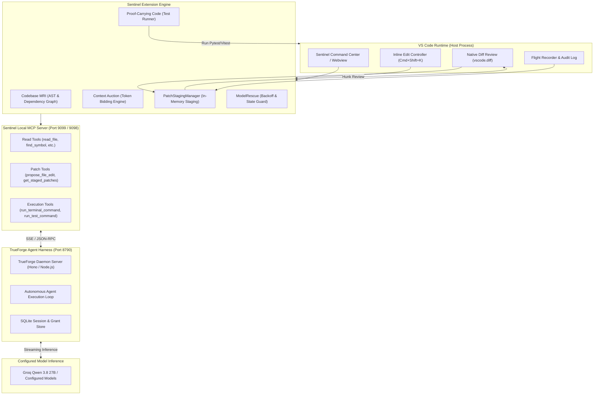

# FORGE//SENTINEL — System Architecture Specification
**Techfest IIT Bombay × TrueFoundry Forge-a-thon 2026–27**  
*Release Candidate 1.0.0 Architecture Document*

> *"Understand First. Plan Intelligently. Change Precisely. Prove Everything."*

---

## 1. Architectural Philosophy & Design Principles

Conventional AI coding assistants function as glorified text-completion engines with destructive tool privileges. They ingest unvetted context, overwrite files without review, hallucinate imports, and produce silent regressions.

**FORGE//SENTINEL** is designed as a repository-intelligent, safety-first engineering command center. Its design enforces six architectural invariants:

1. **Reconnaissance Precedes Mutation:** No patch is generated without analyzing repository AST symbols, dependency graphs, and test linkages (**CODEBASE MRI**).
2. **Context Must Be Budgeted & Proven:** Context is token-bounded and relevancy-ranked; every prompt assembly outputs a verifiable **Context Selection Receipt** (**CONTEXT AUCTION**).
3. **Zero Direct Disk Writes:** The agent cannot overwrite files blindly. All proposed changes are staged as unified diffs in memory (**SURGICAL AI**).
4. **Human-in-the-Loop Diff Review:** Developers inspect changes hunk-by-hunk using native VS Code diff views before disk application (**DIFF REVIEW**).
5. **Transactional Integrity & External Conflict Detection:** Pre-edit SHA-256 hashes prevent clobbering external modifications; full undo restores original state (**TIME MACHINE & FLIGHT RECORDER**).
6. **Resilience & Quarantine:** Model failover and backoff prevent agent crashes; credentials remain quarantined inside TrueForge (**MODEL RESCUE**).

---

## 2. High-Level Component Topology

---

## 3. The Six Core Subsystems

### System 01: CODEBASE MRI (Structural Intelligence & AST Mapping)
- **Engine File:** `src/context/CodebaseMri.ts`
- **Responsibilities:**
  - Ingests workspace TypeScript, JavaScript, and Python source files.
  - Builds an in-memory directed dependency graph: nodes represent files and exported symbols (functions, classes, variables); edges represent import statements, function calls, and subclassing.
  - **Incremental Caching:** Tracks file `mtime` and content hashes. Modifying a single file invalidates only affected AST subgraphs, completing re-indexing in **< 1 ms**.
  - **Topological Sorting & Cycle Detection:** Employs Tarjan's strongly connected components algorithm to handle circular imports gracefully.
  - **Test Mapping:** Correlates source modules with corresponding test suites (e.g. `src/flask/cli.py` $\leftrightarrow$ `tests/test_cli.py`).

### System 02: CONTEXT AUCTION (Deterministic Token Budgeting)
- **Engine File:** `src/context/ContextAuction.ts`
- **Responsibilities:**
  - Solves the context window problem by treating prompt assembly as a knapsack bidding auction.
  - **Bidding Score Function:**
    $$S(c) = w_e \cdot E(c) + w_m \cdot M(c) + w_t \cdot T(c) + w_b \cdot B(c)$$
    - $E(c) \in \{0, 1\}$: Explicit reference weight (`@file`, `@symbol` gets score $1.0$).
    - $M(c) \in [0, 1]$: MRI topological distance from query symbols.
    - $T(c) \in [0, 1]$: Test association linkage.
    - $B(c) \in [0, 1]$: BM25 keyword frequency score.
  - **Sub-File Snippet Windowing:** Files exceeding 2,000 tokens are sliced; only the relevant symbol signature and radius lines are extracted.
  - **Context Selection Receipt:** Emits a deterministic JSON receipt logging selected files, symbol spans, scores, reasons, and token counts.

### System 03: SURGICAL AI (Precision Patch Synthesis)
- **Engine File:** `src/diff/PatchStagingManager.ts`
- **Responsibilities:**
  - Enforces minimum-edit distance diffs formatted as unified diffs.
  - Eliminates whole-file rewrites and accidental syntax deletions.
  - Attaches structured intention metadata to each staged hunk: purpose, risk tier, impacted dependencies, and rollback instructions.

### System 04: PROOF-CARRYING CODE (Automated Verification)
- **Engine File:** `src/flight-recorder/FlightRecorder.ts`
- **Responsibilities:**
  - Automatically executes project test commands (`pytest`, `npm test`) inside an isolated, non-interactive execution runner.
  - Captures execution status, exit code, execution time, and stdout/stderr output.
  - Produces a verifiable **Proof-of-Change Report** validating that modifications pass requirements without regression.

### System 05: TIME MACHINE & FLIGHT RECORDER (Transactional Safety)
- **Engine File:** `src/flight-recorder/FlightRecorder.ts` & `src/diff/PatchStagingManager.ts`
- **Responsibilities:**
  - Maintains pre-edit and post-edit SHA-256 hashes of all staged files.
  - Detects external concurrent modifications: if a file's disk hash differs from staged base hash, patch application is rejected with conflict alerts.
  - Leverages native `vscode.WorkspaceEdit` to provide atomic, multi-file transactional rollbacks.
  - Writes a persistent local audit log to `.sentinel/flight_recorder.json`.

### System 06: MODEL RESCUE (Failover & Immutability)
- **Engine File:** `src/resilience/ModelRescue.ts`
- **Responsibilities:**
  - Traps unreachable TrueForge daemon connections with bounded exponential backoff (100ms, 200ms, 400ms).
  - Handles provider errors and model invalidations without exposing API keys or secrets in error logs.
  - Implements mid-stream abort via `AbortController` and `vscode.CancellationToken`. Aborted turns immediately halt SSE streams and leave the workspace in an unmodified state.

---

## 4. MCP Protocol Implementation

FORGE//SENTINEL embeds a local Model Context Protocol (MCP) server adhering to the MCP 2024-11-05 specification over Server-Sent Events (SSE):

| Tool Name | Type | Description |
| :--- | :--- | :--- |
| `read_file` | Read | Read file contents within workspace boundary. |
| `list_workspace_files` | Read | Enumerate workspace directory tree. |
| `search_workspace` | Read | Perform regex or text search across repository. |
| `find_symbol` | Read | Query AST symbol definitions via Codebase MRI. |
| `inspect_file_structure`| Read | Retrieve file outline and symbol signatures. |
| `retrieve_code_context` | Read | Trigger Context Auction for semantic context assembly. |
| `propose_file_edit` | Proposal | Stage unified diff patch in memory for developer review. |
| `propose_multi_file_edit` | Proposal | Stage coordinated atomic changes across multiple files. |
| `get_staged_patches` | Proposal | Inspect currently staged diffs and metadata. |
| `run_terminal_command` | Execution | Execute controlled terminal commands (write-redirection blocked). |
| `run_test_command` | Execution | Run test suite and capture verification exit codes. |

---

## 5. Security & Isolation Boundaries

1. **Workspace Boundary:** All file paths are validated via `assertPathWithinWorkspace()`; directory traversal (`../`) and out-of-tree symlinks are rejected.
2. **Quarantined Credentials:** LLM API keys are exclusively configured within TrueForge; Sentinel neither accepts nor stores provider tokens.
3. **Interactive Human Approval:** File modifications are never applied silently; each patch requires developer confirmation.
4. **Recursive Masking:** Secrets in nested configurations are sanitized across arbitrary dictionary and list depths.
