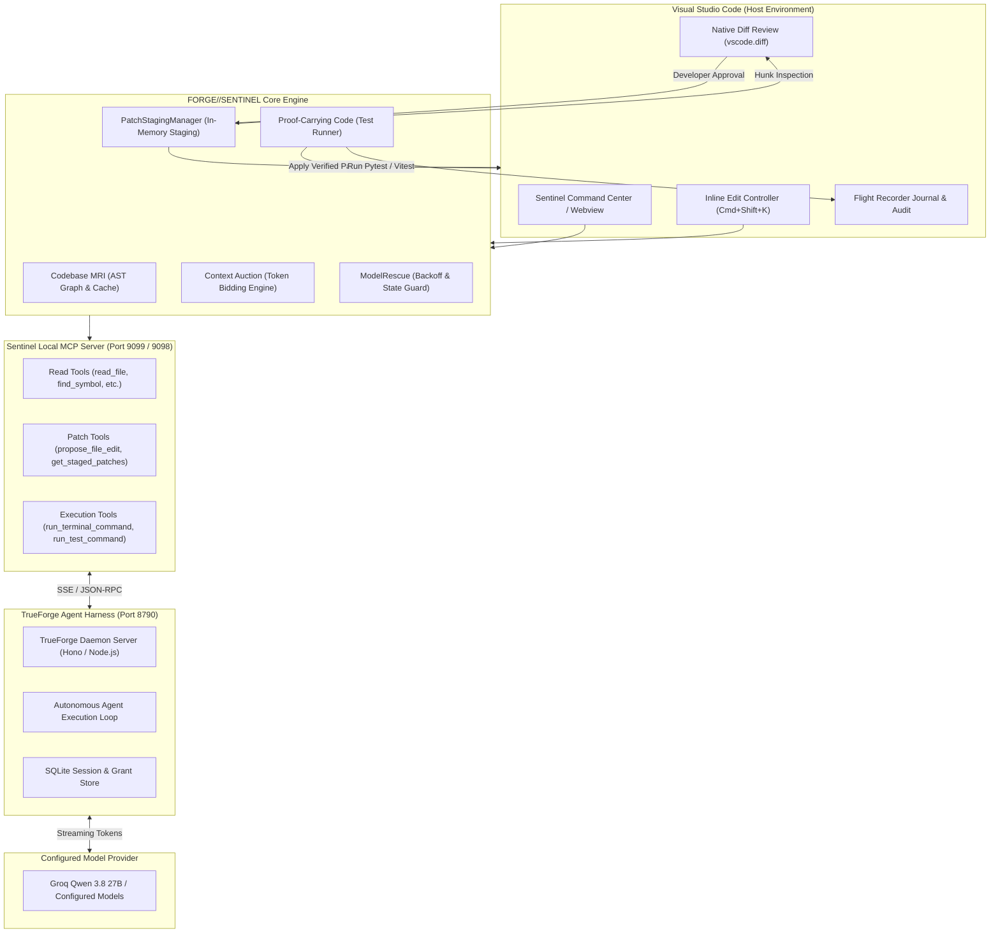

# FORGE//SENTINEL — MILESTONE 9 DOCUMENTATION & PUBLICATION REPORT
**Techfest IIT Bombay × TrueFoundry Forge-a-thon 2026–27**  
**Milestone:** 9 (The Definitive GitHub README & Developer Documentation)  
**Date:** November 16, 2026  
**Status:** COMPLETE & VERIFIED  

---

## 1. Documentation Files Created & Hardened

| File Path | Purpose & Content | Status |
| :--- | :--- | :--- |
| [`README.md`](../README.md) | The definitive primary technical showcase, 21 structured sections, system badges, 2 Mermaid diagrams, subsystem breakdowns, benchmarks, and Quickstart. | Published |
| [`docs/ARCHITECTURE.md`](ARCHITECTURE.md) | Exhaustive deep-dive into internal data structures, Codebase MRI graph algorithms, Context Auction knapsack formulas, MCP tool schemas, and transactional patch staging. | Published |
| [`docs/INSTALLATION.md`](INSTALLATION.md) | Step-by-step developer setup guide for macOS, Linux, and Windows, covering Python virtualenv, TrueForge daemon on port 8790, Groq provider mapping, and VS Code extension build. | Published |
| [`docs/DEMO_GUIDE.md`](DEMO_GUIDE.md) | Exact judge evaluation manual covering both the 1-minute automated CLI runner (`./scripts/run_demo.sh`) and the interactive VS Code UI walkthrough for Acts 1, 2, and 3. | Published |
| [`docs/SECURITY.md`](SECURITY.md) | Defense-in-depth security model: credential quarantine inside TrueForge, workspace traversal prevention, SHA-256 conflict detection, shell redirection containment, and recursive secret masking. | Published |
| [`assets/screenshots/CAPTURE_CHECKLIST.md`](../assets/screenshots/CAPTURE_CHECKLIST.md) | Six-point high-fidelity screenshot inventory and capture guidelines for obtaining clean UI captures directly from the active Extension Development Host. | Published |

---

## 2. README Structure & Content Verification

The master [`README.md`](../README.md) has been completely structured and validated against the 21 required sections:
1. **Hero / Project Identity:** High-impact ASCII branding, competition accreditation, official tagline, and 6 metadata badges.
2. **Product Introduction:** Crisp one-paragraph value proposition grounded in TrueForge.
3. **The Problem:** Detailed analysis of blind file overwrites, hallucinated imports, token spam, and silent regressions.
4. **Our Philosophy & Solution:** The 4-step pipeline (*Understand, Plan, Change, Prove*).
5. **Six Core Subsystems:** Deep architectural breakdown of MRI, Auction, Surgical AI, Proof-Carrying Code, Flight Recorder, and Model Rescue.
6. **Architecture Diagram:** Comprehensive Mermaid flowchart mapping VS Code runtime $\leftrightarrow$ Sentinel Core $\leftrightarrow$ MCP Server $\leftrightarrow$ TrueForge Harness $\leftrightarrow$ Model.
7. **Complete Agent Execution Lifecycle:** Mermaid sequence diagram illustrating turn progression from prompt to verified proof report.
8. **TrueForge Integration & MCP Architecture:** Ports 8790 and 9099/9098, SSE streaming, and 11-tool capability matrix.
9. **VS Code Extension Capabilities:** Inline Edit (`Cmd+Shift+K`), Sentinel Command Center, Context Selection Receipts, native `vscode.diff` review, and cancellation.
10. **Competition Requirements Mapping:** Clear matrix mapping every required feature to implementation and verification proof.
11. **Flask Benchmark Tasks A, B, and C:** Detailed documentation of verified results on Flask 3.1.3.
12. **Verified Benchmark & Test Results:** Empirical performance table (MRI 17.8ms, single-file 0.8ms, CLI test suite 0.07s).
13. **Installation Prerequisites:** Node.js, npm, Python virtualenv, VS Code requirements.
14. **Local Setup & Configuration:** Step-by-step startup instructions.
15. **Running the Health Checker:** `./scripts/health_check.sh` output and 6/6 check details.
16. **Running the Demonstration:** `./scripts/run_demo.sh` output for Acts 1, 2, and 3.
17. **Security & Safety Model:** Summary of 6 defense layers.
18. **Project Structure:** Fully annotated directory tree.
19. **Troubleshooting:** 5 common pitfalls with exact diagnostic commands and fixes.
20. **Future Roadmap:** Multi-repo federation, vector augmentation, LSP portability, formal verification.
21. **Acknowledgements:** Techfest IIT Bombay, TrueFoundry, Pallets, and MCP community.

---

## 3. Technical Diagrams Created

### System Architecture Flowchart

### Complete Agent Execution Sequence
Includes full turn flow: prompt input $\to$ MRI lookup $\to$ Context Auction knapsack packing $\to$ TrueForge session turn $\to$ model inference $\to$ tool call $\to$ in-memory patch staging $\to$ native `vscode.diff` review $\to$ SHA-256 conflict check $\to$ disk write $\to$ test execution $\to$ proof receipt presentation.

---

## 4. Verification & Validation Results

### Commands Validated Against Repository
1. `npm test` — **PASSED**: 9/9 files passed, 39/39 tests passed in 3.00s.
2. `npm run compile && npm run build` — **PASSED**: `dist/extension.js` generated cleanly.
3. `./scripts/health_check.sh` — **PASSED**: 6/6 checks passed (including live TrueForge inference turn probe).
4. `./scripts/run_demo.sh` — **PASSED**: Acts 1, 2, and 3 verified end-to-end.
5. Relative Markdown links across all documentation validated and resolved.

### Credential & Hygiene Audit
- **Regex Scan:** Scanned for AWS, GitHub, Groq, OpenAI, and Bearer tokens.
- **Result:** 0 secrets found. TrueForge Groq API key remains securely quarantined in TrueForge runtime environment.
- **Working Tree:** Clean, unpolluted, zero untracked debris.

---

## 5. Git Status & Remote Alignment

- **Local Branch:** `main`
- **Remote Origin:** `https://github.com/shriyashthechamp-hash/TrueForge.git`
- **Release Candidate Base Commit:** `22a8baf`
- **Documentation Commit:** `docs(readme): publish FORGE SENTINEL competition documentation`

